# Master prompt: Kencana LeadScout CRM deck (Alexander branding)

**What this is:** a ready-to-paste prompt for **Claude Design** that produces a branded slide deck walking through the Kencana LeadScout CRM: the **Hunter tool**, the **Visitation Log tool**, and the dashboards around them. It uses the **Alexander Design System**.

**How to use it**
1. Open Claude Design and start a new **Slides** project.
2. Attach the **Alexander Design System** (your claude.ai design system: https://claude.ai/artifact/9mJR5awSvif4Rb9HgByvWh, originally Claude Design project https://claude.ai/design/p/42307f93-4d17-4cf1-b401-dc749eb4b1a0).
3. Upload every PNG in `docs/crm-deck/screenshots/` (18 files). Keep the filenames, because the prompt refers to them by name.
4. Paste everything between the two `=====` lines below.

> The screenshots come from the real app, running locally on **demo data**. Store names, rep activity, WhatsApp numbers, and every count or percentage in them are synthetic. The SY Hunter company and contact names come from the real BCI project list in the repo. Before showing the deck outside Kencana, blur or swap those names (see the end of the prompt).

---

```
=====================================================================
MASTER PROMPT: KENCANA LEADSCOUT CRM, SYSTEM WALKTHROUGH DECK
=====================================================================

ROLE
You are a senior presentation designer at Alexander Consulting Group.
Build a 16:9 slide deck that presents the Kencana LeadScout CRM, a field-sales
and lead-acquisition platform Alexander engineered for PT Kencana Panelindo
(the first local ACP / aluminium composite panel manufacturer in Indonesia).
The deck must explain each CRM tool clearly enough that a sales director who
has never opened the app understands what each screen does, who uses it,
and what it changes in the sales operation.

AUDIENCE
Kencana leadership and sales management (Head of Sales, BD lead, Retail /
Project / Distributor managers). They are commercial, not technical. They
want to see that the system is real, what each screen is for, and how it
gives them control over field activity and pipeline.

OBJECTIVE
1. Show the CRM as one coherent operating system with two engines:
   (a) the HUNTER tool: outbound acquisition (call, capture WhatsApp,
       hand off, book meeting), and
   (b) the VISITATION LOG tool: field account management (log visit,
       plan the day, track account health, review the team).
2. Walk through each tool screen by screen using the attached screenshots.
3. Close on the management value: visibility, cadence discipline, and
   measurable pipeline.

-------------------------------------------------------------------
BRAND SYSTEM: APPLY THE ATTACHED "ALEXANDER DESIGN SYSTEM" STRICTLY
-------------------------------------------------------------------
Use the attached Alexander Design System as the single source of truth.
If anything below conflicts with it, the design system wins. Key rules:

Color
- Institutional Navy #0B1E36: dark slide background (cover, section
  dividers, screenshot showcase slides).
- Executive Navy #142942: cards and panels on dark slides.
- White #FFFFFF / Canvas #F4F6F8: light editorial slides (text-heavy,
  process diagrams, tables).
- Signal Blue #00A3FF: focal points only (the Signal Period, the single
  key number on a slide, active step in a flow, callout markers on
  screenshots). Never as a large fill.
- Slate #6B7A8D: muted text, borders, captions. Body text on light:
  #3E4A5A. Muted text on dark: #A9B4C2.
- Borders: 1px #E2E8F0 on light, 1px rgba(107,122,141,.25) on dark.
- Status colors (success #1FA971, warning #E0A100, danger #D64545)
  appear ONLY in the account-health / outcome legends.
- No gradients, textures, glassmorphism, or drop shadows on cards.

Typography
- Inter for all interface and data text. Source Serif 4 for the one
  pull-quote per section. JetBrains Mono for system labels (route
  names like /sy-hunter, stage keys like perlu_followup, counts in tables).
- Scale: H1 48 / H2 36 / H3 28 / H4 22 / H5 18 / H6 15 / H7 12.
  H7 eyebrows are UPPERCASE with +0.1em tracking (e.g. "TOOL 01 · HUNTER").
- Sentence case for every heading. Numerals always. No emoji. No
  exclamation marks.
- THE SIGNAL PERIOD: every slide title that is a statement of value
  ends with a period colored Signal Blue. Example:
  "One cockpit for every field call" followed by a Signal Blue "."

Layout
- 12-column grid, generous whitespace, low density, high hierarchy.
- Radius 6–8px on cards and screenshot frames. Hairline 1px borders.
- Logo: Alexander horizontal logo (white on navy slides, navy on light
  slides), small, bottom-left of every slide except the cover. Slide
  number bottom-right in Slate, JetBrains Mono.
- Footer line on content slides: "Kencana LeadScout CRM · Alexander
  Consulting Group" in H7 Slate.

Voice
- Measured, direct, evidence-first. Lead with the outcome, then the
  mechanism. "We engineered…", "Your reps…", "Your managers…".
- Use the product's own Indonesian UI terms where they are labels on
  screen (Kunjungan, Telepon, Eskalasi, My Day, Rack-up, Perlu
  follow-up) and explain each in English the first time it appears.

-------------------------------------------------------------------
SCREENSHOT TREATMENT
-------------------------------------------------------------------
The app's own UI is dark navy with orange (Hunter) and red/gold
(Visitation) accents. Do NOT recolor the screenshots; they are evidence.
Present them inside the Alexander frame:
- Mobile screenshots (390px-wide captures, files 02, 10, 11, 12, 12b,
  20, 21, 22, 23): show inside a minimal, flat phone outline (1px
  Slate border, 28px radius, no glossy device render). Max 2 phones
  per slide, side by side, or 1 phone plus a callout column.
- Desktop screenshots (files 00, 03, 13, 15, 24, 25, 26, 27, 28): show
  inside a flat browser frame (thin top bar with three Slate dots and
  the route in JetBrains Mono, e.g. "leadscout / sy-handler").
- Tall full-page captures (03, 15, 22, 25, 26, 27): CROP to the region
  named on each slide below; never shrink a whole tall page onto one
  slide until it's unreadable.
- Callouts: numbered Signal Blue circles (20px, white numeral) placed on
  the screenshot, with a matching numbered list beside it. Max 5
  callouts per screenshot. Thin 1px Signal Blue leader lines if needed.
- Every screenshot slide has a one-line H7 caption under the frame
  naming the user role and the route, e.g.
  "USED BY: FIELD REP · ROUTE /visits".

-------------------------------------------------------------------
DECK STRUCTURE (22 SLIDES)
-------------------------------------------------------------------

SLIDE 1: COVER (dark, Institutional Navy)
- Eyebrow (H7, Signal Blue): "SYSTEM WALKTHROUGH · KENCANA PANELINDO"
- Title (H1): "Kencana LeadScout CRM" + Signal Period
- Subtitle (lead, 18px): "From cold contact lists to managed accounts:
  the Hunter and Visitation Log tools, screen by screen."
- Bottom-left: Alexander horizontal logo (white). Bottom-right: date.
- No screenshot. Pure type on navy.

SLIDE 2: THE OPERATING PROBLEM (light)
- Title: "Field sales ran on memory and WhatsApp threads" + Signal Period
- Three short columns (H5 heading + 2 lines each):
  1. "Unreachable leads": target lists held landlines and generic
     emails; reps couldn't reach decision makers on WhatsApp.
  2. "Invisible field work": visits and calls weren't logged in one
     place, so managers couldn't see who visited whom, or when.
  3. "Silent churn": repeat accounts went quiet with no alert until
     the order stopped.
- Bottom statement (Source Serif 4 pull quote): "If it isn't logged, it
  didn't happen, and nobody can coach it."

SLIDE 3: THE SYSTEM AT A GLANCE (light, diagram)
- Title: "One platform, two engines" + Signal Period
- Draw a clean two-lane flow diagram (flat boxes, 1px borders, Signal
  Blue arrows only on the active path):
  Lane A, HUNTER (acquisition):
    Target list → Hunter calls & captures WhatsApp → Handler messages,
    gets reply, sets meeting → Won → Champion dashboard
  Lane B, VISITATION LOG (account management):
    Rep logs visit / call / escalation → My Day plans follow-ups →
    Account page tracks health & pipeline → Rack-up (live) & Insights
    (coaching)
- Small note under the diagram: "Mobile-first for reps · live
  dashboards for managers · one shared database".

SLIDE 4: THE HUB (dark, desktop screenshot)
- Screenshot: 00-hub-landing.png (crop to the headline and first two rows
  of tool cards).
- Title: "Every team enters through one hub" + Signal Period
- Side list: Hunter (SY Hunter cockpit + dashboard), Call Cockpit (BD
  pilot), Visitation Logs for Retail / Mirae / Project / Distributor,
  Rack-up dashboards, plus operations modules (Stock, Color Gateway).
- Caption: "USED BY: ALL ROLES · ROUTE /"

SLIDE 5: SECTION DIVIDER (dark)
- Eyebrow: "TOOL 01"
- Title (H1): "The Hunter tool" + Signal Period
- Lead: "Outbound acquisition for the BCI factory and warehouse
  pipeline: call, capture a WhatsApp number, hand off, book a meeting."

SLIDE 6: HOW THE HUNT IS ORGANISED (dark, 2 phones)
- Screenshots: 10-hunter-role-gate.png (left), 11-hunter-day-picker.png
  (right).
- Title: "Three seats, ten days, one prioritised list" + Signal Period
- Callouts:
  1. Role gate: Hunter (call and capture WhatsApp), Handler (message,
     reply, meeting), Champion (live dashboard). Device remembers the seat.
  2. Ten-day plan, about 35 contacts per day.
  3. Each day has a focus: P1 Band A flagship factories first, P3 probes last.
  4. Progress bar per day: worked / captured / warm.
- Fact strip (JetBrains Mono, Slate): "1,078 BCI contacts · 235 factory
  & warehouse targets · Priority P1/P2/P3 × Band A/B/C".

SLIDE 7: THE CALL COCKPIT, ONE LEAD PER SCREEN (dark, 2 phones)
- Screenshots: 12-hunter-call-cockpit.png (left),
  12b-hunter-call-outcomes.png (right).
- Title: "One lead per screen, nothing to think about but the call" + Signal Period
- Callouts (left phone):
  1. Priority + band badge and the live project the company is building.
  2. "Ask for": the named decision maker and their role.
  3. Tap-to-call button.
  4. "Verify on LinkedIn" deep-link: confirm the person before pitching.
     (Deep-link only. We do not scrape LinkedIn.)
  5. Personalised Bahasa Indonesia script with company, contact, and
     project filled in automatically.
- Callouts (right phone):
  1. WhatsApp number capture (+62 format validated).
  2. PIC name if someone else answered; "sample sent" toggle.
  3. Five outcomes: WA captured · Warm, call back · Not interested ·
     No answer · Dead number.
  4. Save & next: the rep never leaves the flow.

SLIDE 8: THE HANDLER PIPELINE (dark, desktop)
- Screenshot: 13-hunter-handler-pipeline.png
- Title: "Every captured number becomes a tracked conversation" + Signal Period
- Callouts:
  1. Stage counters: Fresh → Awaiting reply → Replied → Meeting → Won.
  2. Filter chips per stage.
  3. Lead card: company, contact, project, and how long ago it was
     captured ("reach out" nudge).
  4. One-tap "Open WhatsApp" plus stage buttons (Got a reply, Set
     meeting, Won, Dead).
  5. Note field for the handler's context.
- Side note: "Average time-to-message is tracked: our speed, measured."
- Caption: "USED BY: HANDLER · ROUTE /sy-handler"

SLIDE 9: THE CHAMPION DASHBOARD (dark, desktop, cropped)
- Screenshot: 15-hunter-champion-dashboard.png. Crop to the top half
  (KPI row, By priority, By band, By day, Live capture feed).
- Title: "Leadership sees the hunt live" + Signal Period
- Callouts:
  1. Dialed / WA captured / Capture rate / Warm.
  2. Capture rate by priority tier: which segment converts.
  3. Capture rate by band A/B/C: the strategic quality readout.
  4. Captures per day across the 10-day plan.
  5. Live capture feed, refreshed automatically.
- Mention below: "All captured numbers export to CSV in one click."
- Caption: "USED BY: CHAMPION / SALES LEAD · ROUTE /sy-champion"

SLIDE 10: PROVEN FIRST ON THE BD PILOT (dark, 1 phone + 1 desktop)
- Screenshots: 02-call-cockpit.png (phone, left),
  03-call-champion.png (desktop, right, crop to KPI row + pipeline
  funnel + by-rep).
- Title: "The Hunter pattern was proven on the 600-lead BD pilot" + Signal Period
- Three bullets:
  - Same one-lead-per-screen cockpit for Rep A / Rep B, plus Handler,
    Sales Lead, and Champion seats.
  - Website scraper (WA-Harvest) pre-fills WhatsApp numbers before
    the rep dials, badged "scraped".
  - Champion funnel: captured → messaged → replied → meeting → won,
    with reply rate by tier.

SLIDE 11: HUNTER, WHAT IT CHANGES (light, metric cards)
- Title: "What the Hunter tool gives you" + Signal Period
- Four Executive Metric Cards (H7 eyebrow in Signal Blue → 38px value
  → 14px Slate note). Use STRUCTURAL facts, not demo results:
  - "CONTACT BASE" → "1,078" → "BCI decision makers across 235 targets"
  - "CALL OUTCOMES" → "5" → "standard outcomes, no free-text guessing"
  - "PIPELINE STAGES" → "6" → "fresh → messaged → replied → meeting → won / dead"
  - "TIME TO SCREEN" → "1 tap" → "from captured number to WhatsApp chat"
- Add an empty placeholder card styled the same, labelled
  "LIVE CAPTURE RATE · [insert from /sy-champion]", for the presenter.

SLIDE 12: SECTION DIVIDER (dark)
- Eyebrow: "TOOL 02"
- Title (H1): "The Visitation Log tool" + Signal Period
- Lead: "Field account management for Retail, Mirae, Project, and
  Distributor teams: log every touch, plan every day, never lose an
  account to silence."

SLIDE 13: LOGGING A VISIT (light, 1 phone + explanation)
- Screenshot: 20-visit-log-form.png
- Title: "Logging a visit takes under a minute" + Signal Period
- Callouts:
  1. Three modes: Kunjungan (visit), Telepon (phone call), Eskalasi
     (escalate to a manager).
  2. Rep, PIC name, store name (autocomplete from existing accounts).
  3. Customer type (new / existing) and category (Toko, Workshop,
     Aplikator, Kontraktor, Distributor, Signage…).
  4. Area auto-normalised (e.g. "Jaktim" → "Jakarta Timur") so reports
     group cleanly.
  5. Up to 5 photos, compressed on the phone before upload.
- Trust note (H7 Slate): "Visit time is server-stamped and cannot be
  edited by reps. Manager overrides are audited."
- Caption: "USED BY: FIELD REP · ROUTE /visits"

SLIDE 14: MY DAY, THE REP'S COCKPIT (dark, 2 phones)
- Screenshots: 21-visit-myday.png (left), 22-visit-myday-full.png
  (right, crop to the lower portion showing the account list).
- Title: "Every rep starts the day knowing exactly who to see" + Signal Period
- Callouts:
  1. Rep selector, remembered on the device.
  2. Portfolio chips: All · At risk · Needs follow-up.
  3. "Aksi Hari Ini": scheduled follow-ups due today and overdue.
  4. "Perlu Tindak Lanjut": repeat accounts going quiet, with a
     one-tap "+ Log Kunjungan".
  5. Today's visits with stage badge, PIC, and notes.
- Caption: "USED BY: FIELD REP · ROUTE /myday"

SLIDE 15: THE ACCOUNT PAGE (light, 1 phone + explanation)
- Screenshot: 23-visit-account-detail.png
- Title: "Every account has a health score and a full history" + Signal Period
- Callouts:
  1. Account header: area, category, type (Repeating / Project), owner,
     first seen, last contact.
  2. Health bar: days since last visit vs. the 14-day target.
  3. Pipeline position (Prospek → Penawaran → Negosiasi → Won / Gugur).
  4. One-tap actions: Visit · Call · Received order (with invoice no.) ·
     Note · Schedule follow-up.
  5. Activity timeline and stage history: who did what, when.
- Caption: "USED BY: FIELD REP / MANAGER · ROUTE /account"

SLIDE 16: THE CADENCE ENGINE (light, diagram only)
- Title: "Accounts can't go silent without someone noticing" + Signal Period
- Horizontal 4-step health track (flat pills, status colors allowed
  here only):
  AKTIF (< 10 days since contact) → PERLU FOLLOW-UP (10–13 days) →
  AT RISK (14–16 days) → HIBERNASI (17+ days or never contacted)
- Under it, a second track for project accounts:
  PROSPEK → PENAWARAN → NEGOSIASI → WON / GUGUR
- Explanation (2 lines): "Health is computed live from the last contact
  and re-checked hourly by an automatic cadence engine. Any visit,
  call, or order resets the clock. Managers don't have to chase."

SLIDE 17: RACK-UP, THE LIVE MANAGEMENT BOARD (dark, desktop)
- Screenshot: 24-visit-rackup-dashboard.png (for a second crop, use
  25-visit-rackup-dashboard-full.png at the 7-day trend and the full
  visit table).
- Title: "Managers see the field as it happens" + Signal Period
- Callouts:
  1. Today: total visits, new vs. existing customers, active reps,
     pending escalations.
  2. Per-rep bars: visits today, split new / existing.
  3. Live feed of the latest visits (blue = new, green = existing).
  4. 7-day trend, full visit table, XLSX export.
  5. Escalation inbox: resolve, and the rep sees it on My Day.
- Caption: "USED BY: SALES MANAGER · ROUTE /visits-rack"

SLIDE 18: INSIGHTS, COACHING FROM DATA (dark, desktop, 2 crops)
- Screenshot: 26-visit-insights.png. Crop A: team summary + pipeline +
  leaderboard (top third). Crop B: two per-rep scorecards + the coverage
  heatmap (bottom).
- Title: "Coach each rep on behaviour, not anecdote" + Signal Period
- Callouts:
  1. Team summary for any period: visits, new customers, unique stores,
     active reps.
  2. Project pipeline and repeating-account health for the whole team.
  3. Leaderboard by visits or new customers.
  4. Per-rep archetype, auto-derived: Hunter vs. Maintainer, Specialist,
     Anchored vs. Roamer, with Hunter Index (% new customers), visits per
     active day, unique stores, and notes discipline.
  5. Area × category coverage heatmap: where you're under-covered.
- Disclaimer line (H7 Slate, as in the product): "Measures visit
  behaviour, not sales results. Read alongside transaction data."

SLIDE 19: REP PROFILE + AI SYNTHESIS (dark, desktop)
- Screenshot: 27-visit-rep-profile.png (crop to the KPI row, the AI
  synthesis card, and the first day of the visit log).
- Title: "Each rep has a profile and an on-demand AI summary" + Signal Period
- Callouts:
  1. Date range: 7 / 30 days or custom.
  2. Totals: visits, new, existing, active days, visits per day.
  3. "Sintesis AI": generates a written synthesis of the rep's visit
     notes for the period on demand, never automatically.
  4. Day-grouped visit log with store, PIC, type, category, area, notes.

SLIDE 20: ONE PLATFORM, FOUR BUSINESS LINES (light)
- Screenshot (small, right): 28-visit-salespeople-admin.png
- Title: "The same tool runs every sales team, with separate data" + Signal Period
- Left: four flat cards: Retail · Mirae · Project · Distributor. Each
  has its own visit log, My Day, Rack-up, and Insights, with data kept
  separate.
- Bullets: reps added or deactivated by admins without losing history ·
  categories and areas managed as lists · one-click export of all
  visitation data (XLSX) and the full database (ZIP).

SLIDE 21: BUILT TO BE TRUSTED (light, 2×3 grid of short tiles)
- Title: "Engineered for data you can act on" + Signal Period
- Six tiles (Lucide line icon + H6 + one line):
  - Mobile-first: built for reps on a phone in the field.
  - Server-stamped time: visit times can't be backdated by reps.
  - Audit trail: every manager override is logged.
  - Clean geography: area names normalised on write.
  - WhatsApp-only numbers: landlines rejected, +62 mobiles validated.
  - Safe verification: LinkedIn deep-links, never scraping.

SLIDE 22: CLOSE (dark)
- Eyebrow: "NEXT STEPS"
- Title: "From visibility to velocity" + Signal Period
- Three numbered next steps (H5 + one line):
  01 Roll the Hunter cadence to P2/P3 tiers and report weekly capture rate.
  02 Make My Day the start-of-day ritual for every field rep.
  03 Run monthly coaching from Insights archetypes and the coverage heatmap.
- Bottom-left: Alexander logo. Bottom-right: contact placeholder
  "[name] · [email]".

-------------------------------------------------------------------
QUALITY BAR
-------------------------------------------------------------------
- Every claim on a slide must be visible in the screenshot or listed in
  this prompt. Don't invent metrics, customer names, or results.
- Numbers visible inside screenshots are demo data. Never quote them as
  business results in slide titles or metric cards.
- One idea per slide. A title that reads as a full sentence, ending in
  the Signal Period.
- Text contrast ≥ 4.5:1 on every background.
- Speaker notes on every slide: 3–5 sentences the presenter can say,
  explaining who uses the screen and what decision it enables.

PRIVACY (APPLY BEFORE EXTERNAL SHARING)
- Screenshots 12, 13, and 15 show real company and contact names from
  the BCI project list. For any audience outside Kencana, apply a soft
  blur over contact names and phone numbers. Company names may stay if
  the client approves.

DELIVERABLE
A 22-slide 16:9 deck in the Alexander Design System, exportable to
PPTX and PDF, with speaker notes.
=====================================================================
```

---

## Screenshot index

All captured from the running app at 2× resolution. Mobile = 390×844 viewport. Desktop = 1440×900 viewport. "Full" files are full-page captures meant to be cropped.

| # | File | Tool | Route | Slide |
|---|---|---|---|---|
| 00 | `00-hub-landing.png` | Hub | `/` | 4 |
| 02 | `02-call-cockpit.png` | BD Call Cockpit (role gate) | `/calls` | 10 |
| 03 | `03-call-champion.png` | BD Champion dashboard (full) | `/champion` | 10 |
| 10 | `10-hunter-role-gate.png` | Hunter: role gate | `/sy-hunter` | 6 |
| 11 | `11-hunter-day-picker.png` | Hunter: 10-day picker | `/sy-hunter` | 6 |
| 12 | `12-hunter-call-cockpit.png` | Hunter: lead card + script | `/sy-hunter` | 7 |
| 12b | `12b-hunter-call-outcomes.png` | Hunter: WA capture + outcomes | `/sy-hunter` | 7 |
| 13 | `13-hunter-handler-pipeline.png` | Hunter: Handler pipeline | `/sy-handler` | 8 |
| 15 | `15-hunter-champion-dashboard.png` | Hunter: Champion (full) | `/sy-champion` | 9 |
| 20 | `20-visit-log-form.png` | Visitation: log form | `/visits` | 13 |
| 21 | `21-visit-myday.png` | Visitation: My Day | `/myday` | 14 |
| 22 | `22-visit-myday-full.png` | Visitation: My Day (full) | `/myday` | 14 |
| 23 | `23-visit-account-detail.png` | Visitation: account page | `/account` | 15 |
| 24 | `24-visit-rackup-dashboard.png` | Visitation: Rack-up | `/visits-rack` | 17 |
| 25 | `25-visit-rackup-dashboard-full.png` | Visitation: Rack-up (full) | `/visits-rack` | 17 |
| 26 | `26-visit-insights.png` | Visitation: Insights (full) | `/visits-insights` | 18 |
| 27 | `27-visit-rep-profile.png` | Visitation: rep profile (full) | `/visits-rep` | 19 |
| 28 | `28-visit-salespeople-admin.png` | Visitation: sales admin | `/salespeople` | 20 |

### Hunter tool

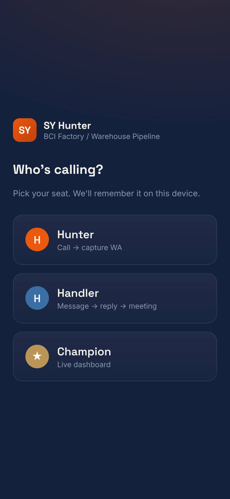
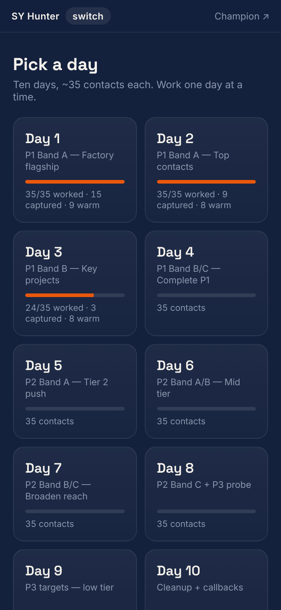
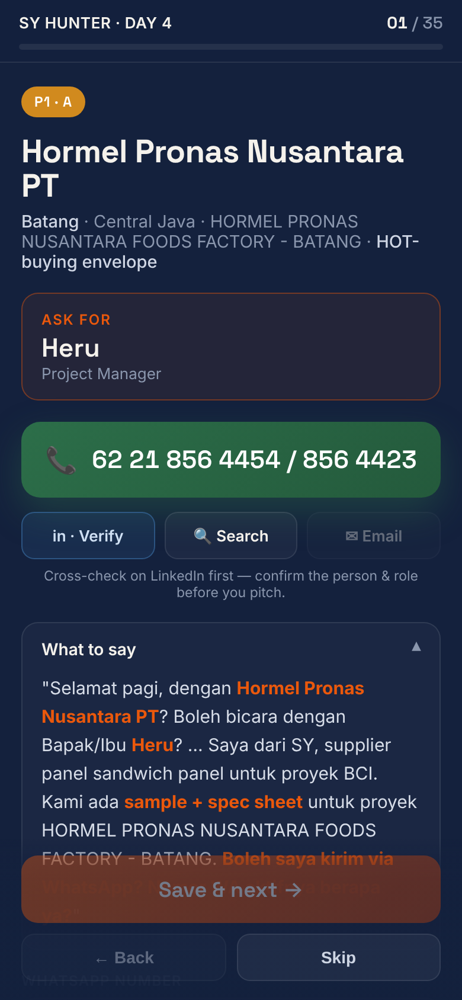
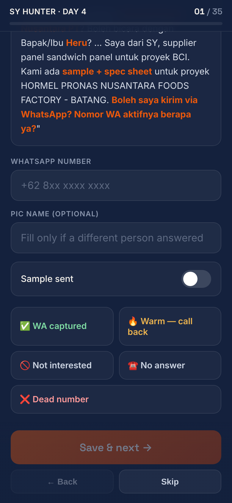
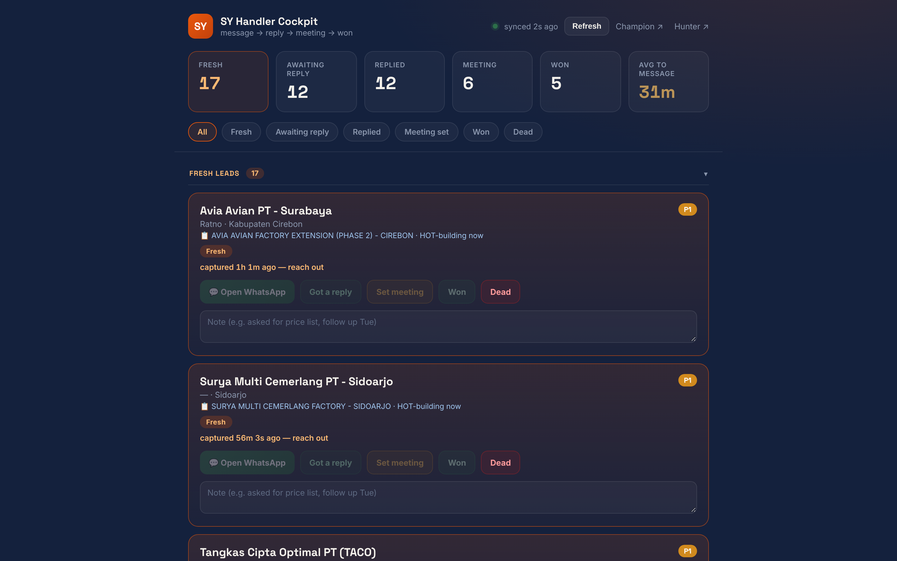
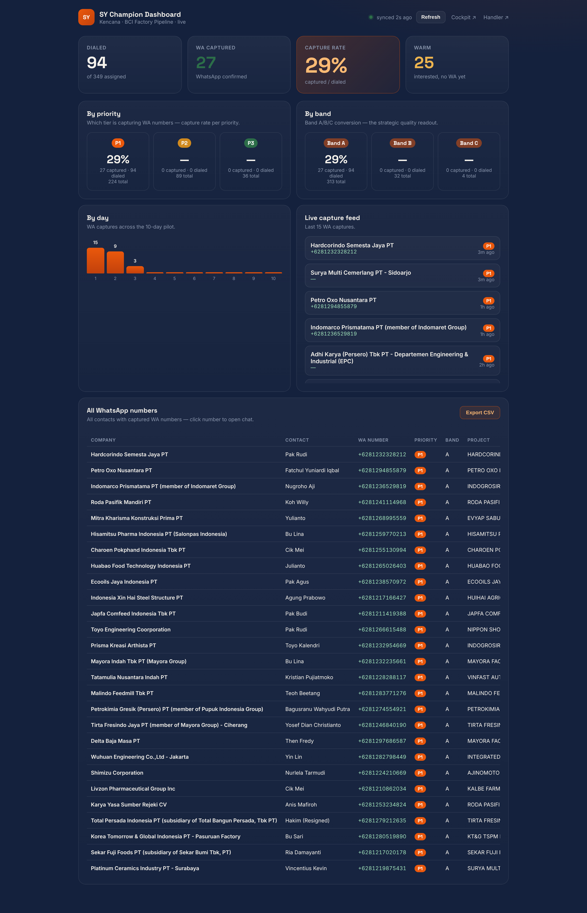

### Visitation Log tool

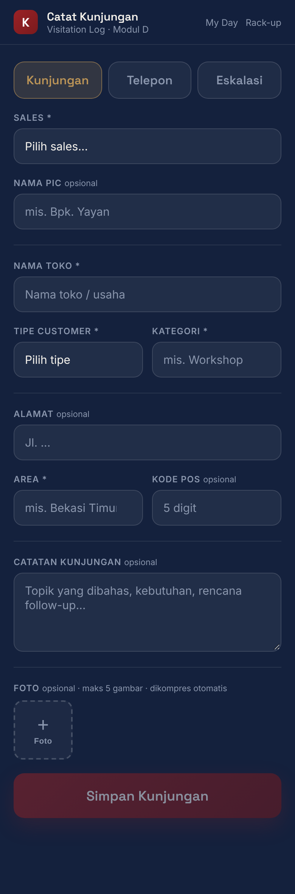
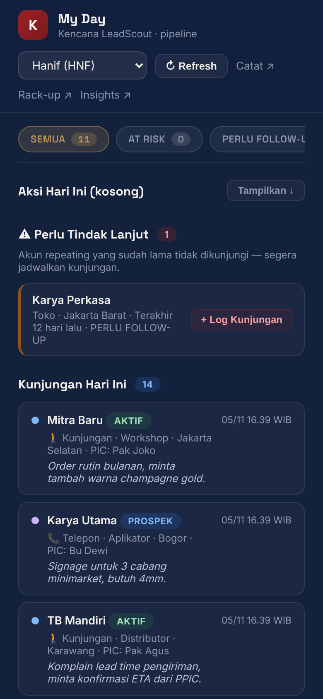
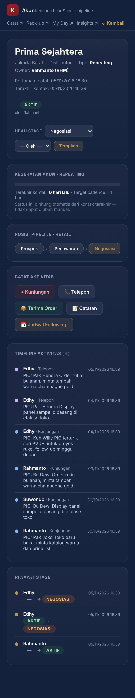
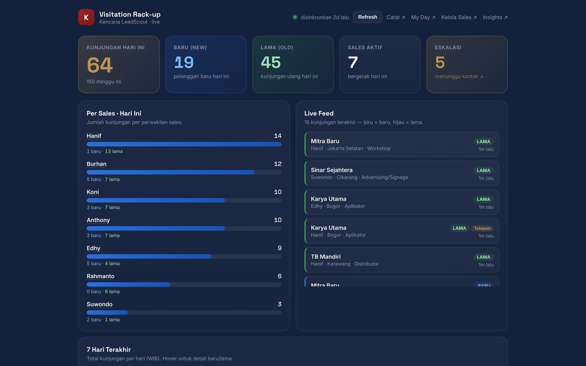
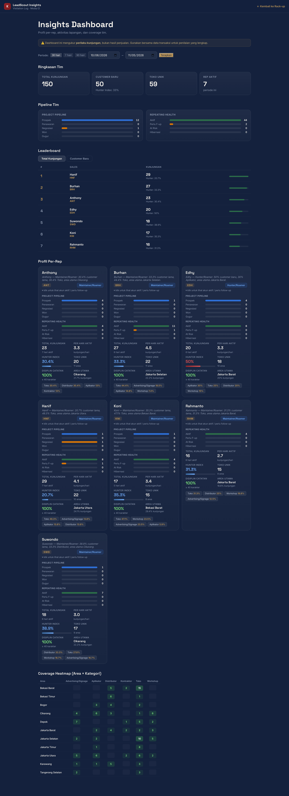
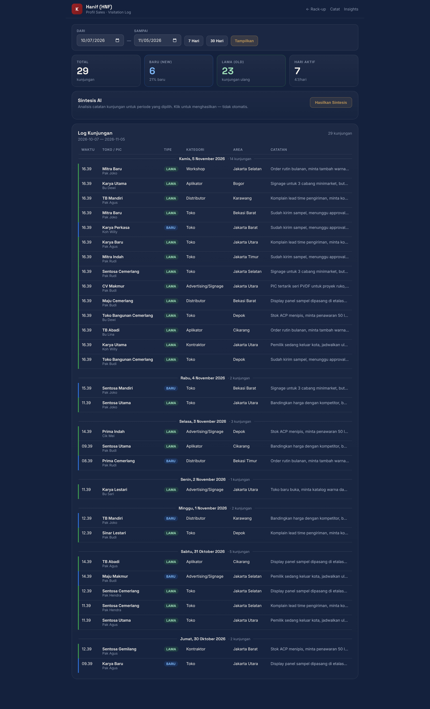
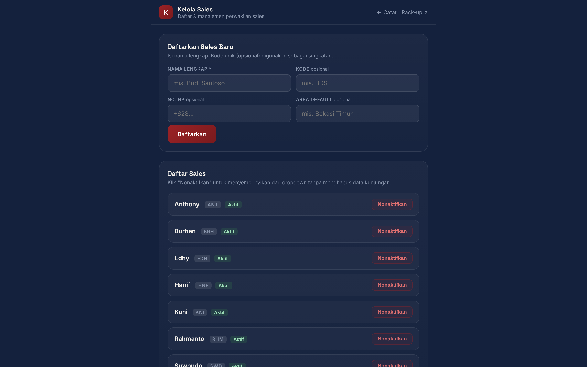

### Hub and BD pilot

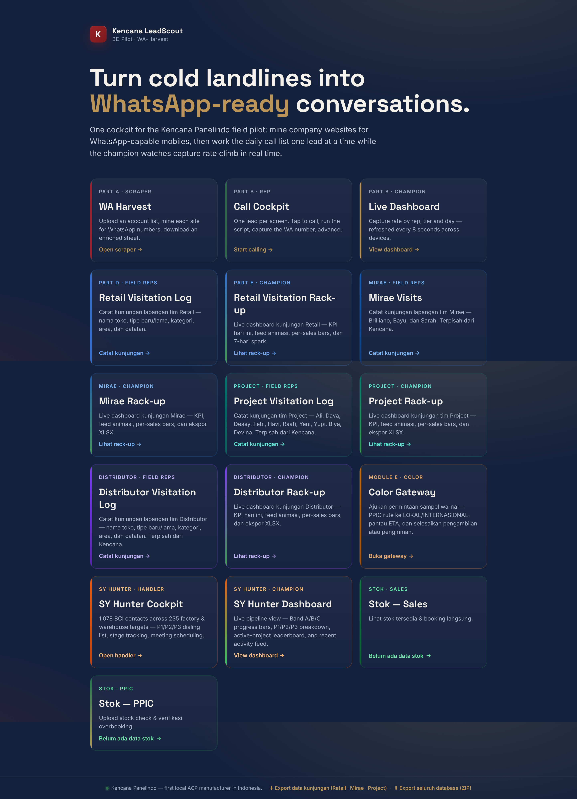
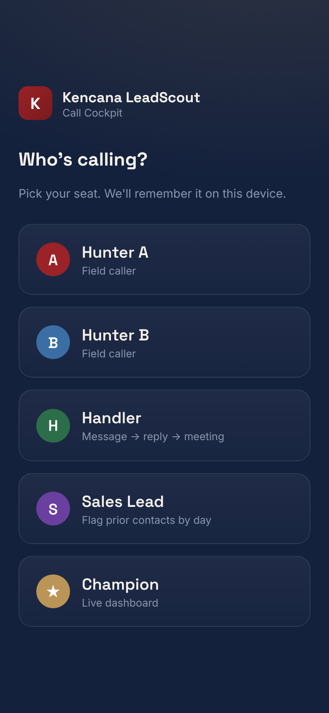
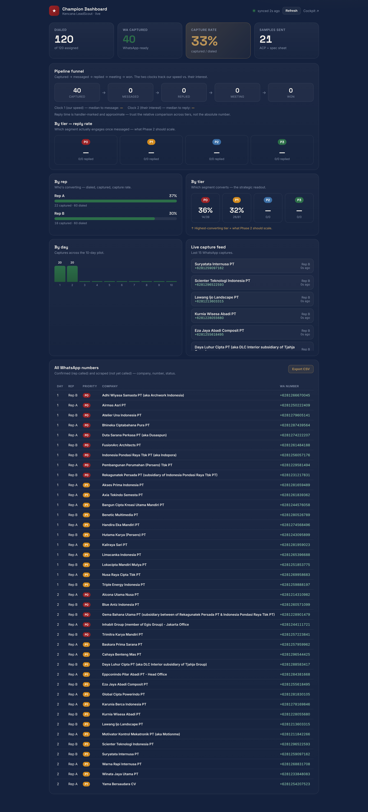

---

## Left out on purpose

- **Stock (`/stock`, `/stock-ppic`)**: shows "ERP tidak terhubung" without the Selaras ERP credentials, so a screenshot would only show an empty state.
- **Color Gateway (`/color-gateway`)**: had no sample requests in the demo data.
- **WA-Harvest scraper (`/scraper`)**: the upload drop zone renders misaligned in headless capture. It's mentioned in slide 10 copy instead.

To add any of these, capture them from production and add a slide after slide 20.
